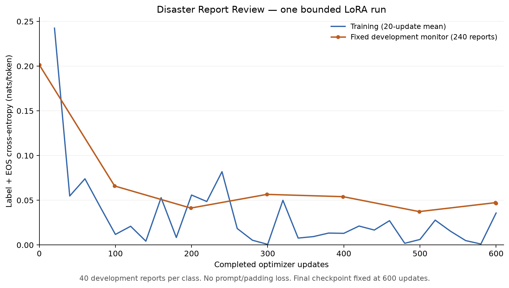

# Disaster Report Review

Week 5 custom project. A local classifier suggests one of six NOAA event
categories for a historical narrative. An analyst reviews the original text,
compares the suggestion with the keyword baseline, saves a decision, and
exports the reviewed records. The workspace supports unresolved decisions and
keeps linked source attribution with the review.

This source snapshot comes from `working-review-app-v2` at `650240e`.
See [setup and reproduction](docs/SUBMISSION_SETUP.md),
and [attribution and asset scope](docs/ATTRIBUTION.md).

## Recorded development results

All rows use the same 2,449 episode- and duplicate-grouped development reports.

| Method | Accuracy | Macro-F1 |
| --- | ---: | ---: |
| Untuned Qwen raw completion | 71.74% | 77.41% |
| Keyword baseline | 89.02% | 88.10% |
| Merged LoRA raw completion, offline batch of eight | 98.73% | 98.79% |
| Merged LoRA served by the app, one report at a time | 98.69% | 98.76% |
| Untuned Qwen, constrained letter protocol | 26.46% | 26.85% |
| Merged LoRA, constrained letter protocol | 63.33% | 56.20% |

The app uses the raw completion protocol. The offline and served raw runs differ
on one prediction. The weaker constrained letter comparison also showed 48
prediction changes from adapter to merged. The reserved final set remains
untouched. Results apply to this historical development split. The Wildfire
class has 41 examples.

The run used 600 updates, batch size 4, learning rate 0.0001 and LoRA rank 8.
It saw 2,400 distinct training reports, 21% of one pass. Fixed monitor loss fell
from 0.2015 to 0.0468 with fluctuations. The saved BF16 merge passed five smoke
cases. See [training and matched evaluation](docs/LORA_RUN.md),
[per-class serving results](docs/REVIEW_APP.md), and
[handout alignment](docs/HANDOUT_ALIGNMENT.md).

