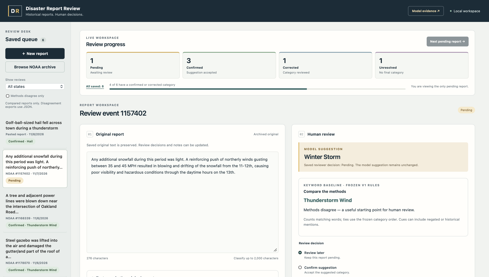
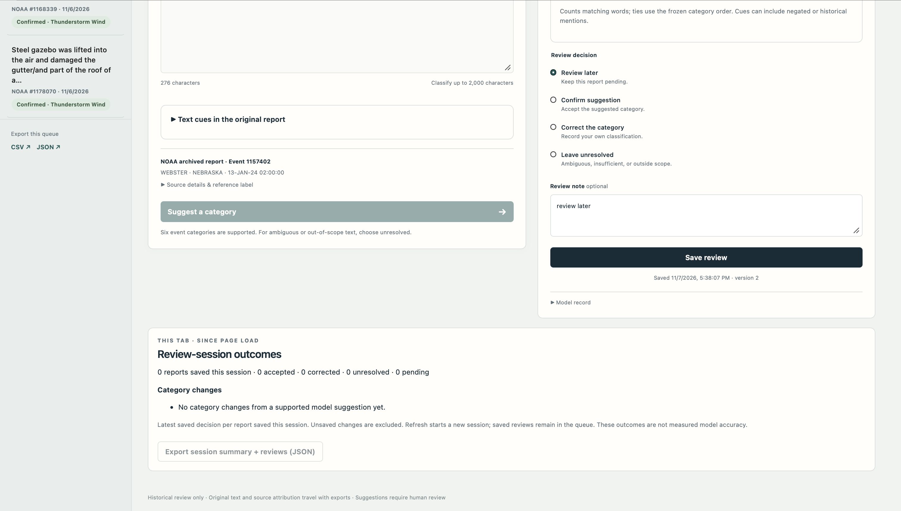
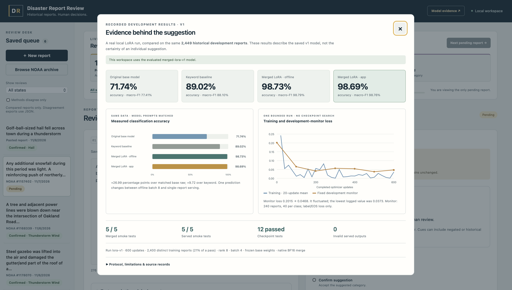
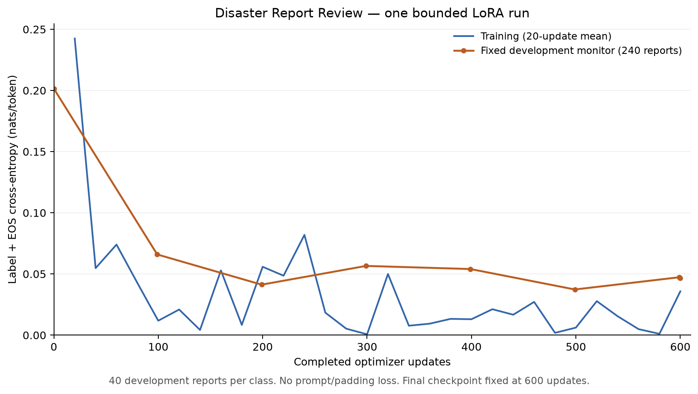

# Disaster Report Review

Analysts preparing historical disaster datasets must read narrative reports, assign consistent event categories, and resolve ambiguous cases. Disaster Report Review helps with this work by using a local model to suggest one of six NOAA event categories. Analysts can inspect the original text, compare the suggestion with a keyword baseline, and confirm, correct, or leave the report unresolved. Saved reviews preserve linked source attribution and can be exported for further analysis.

## Demo

[Watch the Loom walkthrough](https://www.loom.com/share/10f58f9740074e0dbec9a0b0a3f76ecc)

### Review desk and method comparison

The original narrative sits beside the model suggestion and keyword baseline, with saved-state counts and a disagreement filter.

### Human review and export

Analysts can confirm, correct, or leave a report unresolved, preserve source details, and export saved records and session outcomes.

### Model evidence

The evidence panel presents recorded development comparisons and the training loss curve.

## My contribution

I developed this custom project during the GenAI Academy cohort, where fine-tuning was a requirement. I chose historical disaster-report classification and built the analyst review workflow around it.

I built an end-to-end review workflow, prepared data splits that kept related and duplicate reports together, fine-tuned and merged a local model, and compared it with untuned-model and keyword baselines.

Fine-tuning was explored to improve six-category classification of disaster narratives. On the development set, the served model reached **98.69% accuracy**, compared with **71.74%** for the untuned model and **89.02%** for keywords.

## Limitations

The project covers six categories from one historical NOAA snapshot. Some narratives can support more than one plausible category. Classes are imbalanced, and performance on other sources remains unvalidated. Training covered 21% of one epoch, the separate letter protocol performed substantially worse, and the reserved final set remains unevaluated. Human review is central to the workflow.

This source snapshot comes from `working-review-app-v2` at `650240e`.
See [setup and reproduction](docs/SUBMISSION_SETUP.md),
and [attribution and asset scope](docs/ATTRIBUTION.md).

## Recorded development results

All rows use the same 2,449 episode- and duplicate-grouped development reports.

| Method | Accuracy | Macro-F1 |
| --- | ---: | ---: |
| Untuned Qwen raw completion | 71.74% | 77.41% |
| Keyword baseline | 89.02% | 88.10% |
| Merged LoRA raw completion, offline batch of eight | 98.73% | 98.79% |
| Merged LoRA served by the app, one report at a time | 98.69% | 98.76% |
| Untuned Qwen, constrained letter protocol | 26.46% | 26.85% |
| Merged LoRA, constrained letter protocol | 63.33% | 56.20% |

The app uses the raw completion protocol. The offline and served raw runs differ
on one prediction. The weaker constrained letter comparison also showed 48
prediction changes from adapter to merged. The reserved final set remains
untouched. Results apply to this historical development split. The Wildfire
class has 41 examples.

The run used 600 updates, batch size 4, learning rate 0.0001 and LoRA rank 8.
It saw 2,400 distinct training reports, 21% of one pass. Fixed monitor loss fell
from 0.2015 to 0.0468 with fluctuations. The saved BF16 merge passed five smoke
cases. See [training and matched evaluation](docs/LORA_RUN.md),
[per-class serving results](docs/REVIEW_APP.md), and
[handout alignment](docs/HANDOUT_ALIGNMENT.md).

