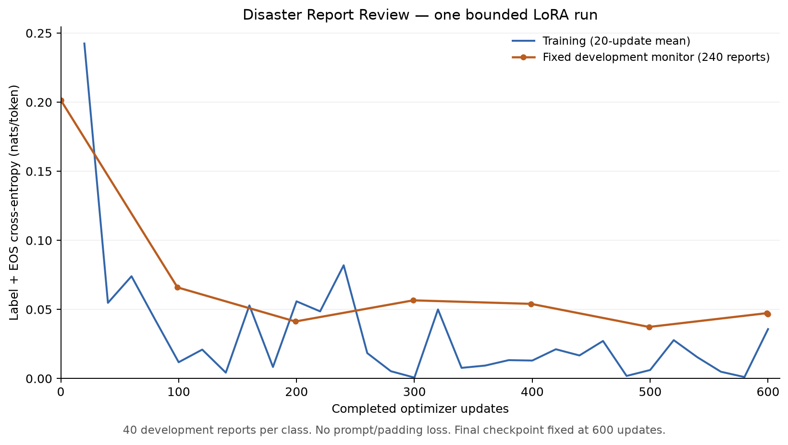
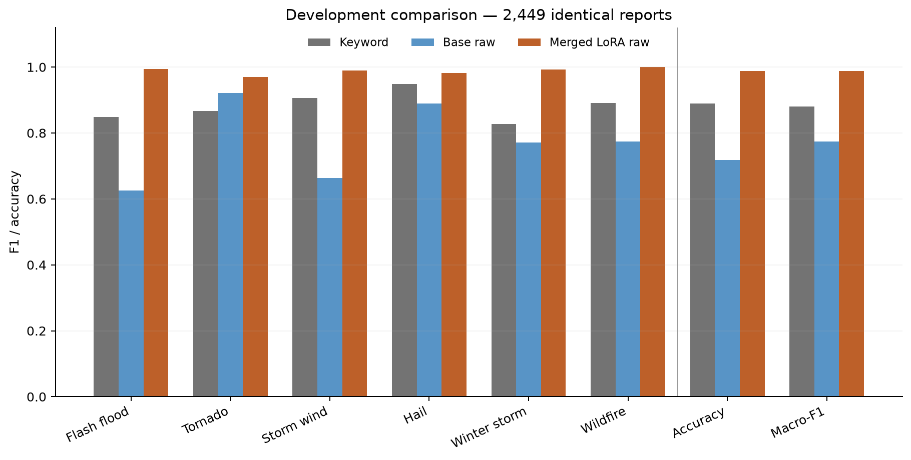
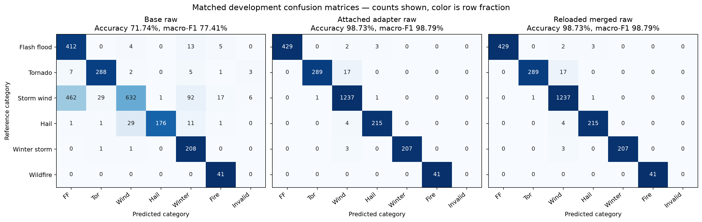

# One bounded LoRA run — November 6, 2026

One actual offline LoRA run completed, followed by loss review, standalone merge,
five predeclared smoke cases and full matched development evaluation. No reserved
final manifest was opened and no final predictions were produced. Curator’s
Studio was not used. No prompt/configuration sweep or best-checkpoint search ran.

## Run and data evidence

- Final checkpoint: 600 optimizer updates, batch size 4, constant Adam learning
  rate 0.0001; seed 0; no gradient accumulation or class reweighting.
- 2,400 exposures, all distinct, from 11,430 available training rows
  (21.00% of train, a partial pass rather than a full epoch).
- Rank 8, native MLX scale 20, dropout 0; q_proj/v_proj in the last 16 layers.
  917,504 trainable parameters. Only LoRA tensors were trainable.
- All frozen base tensor hashes were unchanged after training. Base revision:
  `ea980cb0a6c2ae4b936e82123acc929f1cec04c1`.
- Training took 247.6 seconds; peak MLX memory 5.82 GB.
- Raw prompt is identical to the saved base diagnostic. Supervise the full exact
  label plus EOS 151643; no chat template, prompt loss, padding loss or truncation.
  Maximum training sequence was 509 tokens; maximum development sequence 486.
- The standard MLX completion dataset would apply a chat template. This run uses
  an explicit pretokenized dataset and completion loss to preserve the raw
  contract. The mask targets original positions >=prompt_length and
  <sequence_length. Actual-batch checks and a padding-invariance test passed.

| Training reference class | Actual examples seen |
| --- | ---: |
| Flash Flood | 444 |
| Tornado | 332 |
| Thunderstorm Wind | 1183 |
| Hail | 195 |
| Winter Storm | 204 |
| Wildfire | 42 |

The predeclared configuration, source/split hashes, batch-mask audit, monitor IDs,
actual exposure IDs, loss log and frozen-base hashes are in `data/training/lora-v1/`.
The final adapter is ignored at `runtime/lora-v1/adapters.safetensors`:
`52b33c73a8e6ff0941713ea9c75f2a2b12acbe28267d147c24dc7b23d7a92233`.

## Loss review

Training 20-update mean: 0.242467 initially to
0.035762 for the last 20 updates. Fixed-monitor loss:
0.201500 before training to 0.046790
after reloading final600. Lowest logged monitor loss was 0.037320
at completed update 499; final loss is 0.009470 higher.

The curve decreases overall but fluctuates and rebounds from its minimum.
It does not show monotonic improvement or establish that more training would
help. The final600 checkpoint was selected before training and retained.
The monitor contains 40 development reports per class (240 total), selected by
SHA-256 of event ID before predictions. It is label-balanced, not full-population
development loss. Loss is per supervised label/EOS token; training points average
20 changing minibatches. These are teacher-forced losses, not classification
accuracy. Training callback validation points 0,99,...599 occur before the next
update; a separate final600 measurement uses the saved adapter.



## Standalone merge and smoke tests

Native MLX fusion folded 32 adapted linear layers into BF16 base weights.
No quantization, GGUF conversion, upload or hosted inference occurred. The
standalone artifact is `runtime/merged-lora-v1/`; file hashes are in
`merged-manifest.json`. It has 1,720,574,976 parameters, no adapter configuration
dependency and retains the upstream Apache 2.0 license and attribution.
Saved-tokenizer parity passed for both protocols on all 2,449 development rows.

The actual saved/reloaded merged artifact passed 5/5 smoke cases before full
classification evaluation. These cover five of six classes; they are a sanity
check, not an input-coverage or out-of-scope evaluation.

| Expected | Actual merged output | Result |
| --- | --- | --- |
| Tornado | Tornado | Pass |
| Hail | Hail | Pass |
| Winter Storm | Winter Storm | Pass |
| Wildfire | Wildfire | Pass |
| Flash Flood | Flash Flood | Pass |

## Matched development results

All methods below use the identical 2,449 frozen development IDs, reference
labels and order. Accuracy, macro-F1, class precision/recall/F1/support and
confusion matrices were independently recomputed from saved predictions.
Invalid completions count as incorrect. Reference labels were never changed.

| Method | Accuracy | Macro-F1 | Invalid |
| --- | ---: | ---: | ---: |
| Keyword | 89.02% | 88.10% | 0 |
| Base raw completion | 71.74% | 77.41% | 9 |
| Attached adapter raw | 98.73% | 98.79% | 0 |
| Reloaded merged raw | 98.73% | 98.79% | 0 |
| Base handout letter | 26.46% | 26.85% | 0 |
| Attached adapter letter | 64.03% | 56.54% | 0 |
| Reloaded merged letter | 63.33% | 56.20% | 0 |

Merged raw accuracy changes: +26.99 percentage points versus
matched base raw; +9.72 points versus keyword. Macro-F1 changes
+21.38 points versus matched base raw.

The raw protocol is unchanged: raw prompt, greedy 16-token budget, EOS stop,
exact full-label parser, batch size 8. The separate letter protocol preserves
the handout first-step constrained A–F scoring, same chat prompt and same single
letter IDs for every artifact. The model was trained for raw completion, so a
letter-protocol regression must be reported, not hidden. Cross-format deltas
do not isolate training gains. The weak base-letter score is not the sole
benchmark; the stronger keyword and base-raw results remain visible.



### Merged raw per-class report

| Reference | Precision | Recall | F1 | Support | F1 delta vs base raw | F1 delta vs keyword |
| --- | ---: | ---: | ---: | ---: | ---: | ---: |
| Flash Flood | 100.00% | 98.85% | 99.42% | 434 | +36.81 pp | +14.61 pp |
| Tornado | 99.66% | 94.44% | 96.98% | 306 | +4.82 pp | +10.37 pp |
| Thunderstorm Wind | 97.94% | 99.84% | 98.88% | 1239 | +32.60 pp | +8.28 pp |
| Hail | 98.17% | 98.17% | 98.17% | 219 | +9.28 pp | +3.39 pp |
| Winter Storm | 100.00% | 98.57% | 99.28% | 210 | +22.10 pp | +16.60 pp |
| Wildfire | 100.00% | 100.00% | 100.00% | 41 | +22.64 pp | +10.87 pp |

Full per-class reports and confusion matrices for every artifact/protocol are
in `data/evaluations/*-lora-v1-*/metrics.json`; the audited combined report is
`data/training/lora-v1/comparison.json`. Rows are references and columns are
predictions, with a separate INVALID column.



### Largest merged raw confusions

- Tornado → Thunderstorm Wind: 17 reports.
- Hail → Thunderstorm Wind: 4 reports.
- Flash Flood → Hail: 3 reports.
- Winter Storm → Thunderstorm Wind: 3 reports.
- Flash Flood → Thunderstorm Wind: 2 reports.
- Thunderstorm Wind → Tornado: 1 report.

Qualitative spot review of six adapter errors is recorded in `error-review.json`.
Examples include an EF-0 report missed as Wind, damage-only Tornado narratives,
a snow-squall report dominated by wind measurements, a combined hail/wind report,
and source Wind event 1211898 whose narrative describes a landspout. This is
diagnostic review, not relabeling. Human unresolved/correction support remains
necessary; reference-label accuracy is not semantic certainty.

### Metric regressions versus matched base

The following decreases remain visible even when aggregate accuracy or class
F1 improves. Scores are closed-set reference-label measurements, not calibrated
confidence. No second run or threshold change was triggered.

| Protocol | Class | Metric | Base | Merged | Change |
| --- | --- | --- | ---: | ---: | ---: |
| raw | Hail | precision | 99.44% | 98.17% | -1.26 pp |
| raw | Winter Storm | recall | 99.05% | 98.57% | -0.48 pp |
| letter | Flash Flood | precision | 84.24% | 65.91% | -18.34 pp |
| letter | Tornado | precision | 63.55% | 47.88% | -15.67 pp |
| letter | Tornado | f1 | 74.11% | 63.91% | -10.20 pp |
| letter | Thunderstorm Wind | precision | 100.00% | 98.75% | -1.25 pp |
| letter | Hail | precision | 100.00% | 95.07% | -4.93 pp |
| letter | Winter Storm | recall | 99.05% | 9.52% | -89.52 pp |
| letter | Winter Storm | f1 | 21.71% | 17.39% | -4.32 pp |

## Merge drift

- raw: 0 adapter/merged label disagreements; agreement 100.0000%.
  Raw completion strings differ on 0 rows; token sequences on 0 rows.
- letter: 48 adapter/merged label disagreements; agreement 98.0400%.
  Choice-logit absolute drift: max 0.250000, mean 0.047494.

Native fusion casts the low-rank delta to BF16 before adding it to BF16 base
weights. Attached inference and fused inference need not be numerically
identical. The comparison records every label disagreement by event ID instead
of assuming merge equivalence. No quantization was used.

## Reproduce and continue

Use the isolated `.venv` and pinned base/environment from `LOCAL_MODEL_SETUP.md`.
Create the separate plotting environment if needed:

```sh
UV_CACHE_DIR="$PWD/work/uv-cache" uv venv --python .venv/bin/python work/plot-env
UV_CACHE_DIR="$PWD/work/uv-cache" uv pip install --python work/plot-env/bin/python -r requirements-plot.lock
```

The original first-run sequence was:

```sh
.venv/bin/python scripts/train_lora.py
.venv/bin/python scripts/review_lora_loss.py
work/plot-env/bin/python scripts/plot_lora_loss.py
.venv/bin/python scripts/merge_lora.py
.venv/bin/python scripts/evaluate_lora.py --artifact merged --smoke
.venv/bin/python scripts/run_matched_lora_evaluation.py
work/plot-env/bin/python scripts/plot_lora_evaluation.py
.venv/bin/python scripts/write_lora_report.py
.venv/bin/python scripts/audit_lora_evidence.py
```

Preserve existing v1 evidence: training/merge/completed evaluation refuse
overwrite; the evaluation driver preserves completed stages and validates their
hashes. Do not launch another run simply to regenerate a document. Plotting uses
a separate ignored environment pinned in `requirements-plot.lock`; it does not
change the model environment. All model stages are offline and local.

This completes the local training/merge/development milestone, not the full
submission or a model deployment decision. The user explicitly accepted the
local MLX/custom-data adaptation to the handout; no LLaMA Board execution is
claimed. Remaining work: one human-review application workflow, evaluation of
the actual served artifact, dataset/code/model attribution and reproducibility
assets, GitHub publication and Loom demonstration. Keep the reserved final
untouched until a separately predeclared final evaluation is authorized.

Dataset limits remain: one year, uncertain label/text alignment, class imbalance,
same-label duplicates, row-weighted evaluation, unknown upstream pretraining
overlap, and only 41 development Wildfire reports. Closed-set scores and five
smoke cases do not establish confidence calibration or arbitrary-input coverage.
