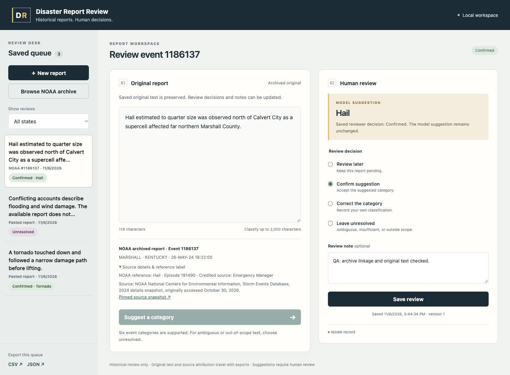

# Local review app and served-model evaluation

## Start the app

From this repository, with its existing isolated model environment:

```sh
.venv/bin/python -m review_app
```

On macOS you can also double-click `start-review.command` in this repository.

Open http://127.0.0.1:8877 after the terminal prints the local URL. The first
load verifies the merged model files and initializes MLX on the Apple GPU.
The default database is `runtime/review-app.sqlite3`; it starts empty. It is a
new project-local SQLite database, not another project’s database. Model weights,
database files and QA data are ignored by Git. All inference stays offline.

If this port is occupied, choose `--port 8878`; leave the existing service alone.
Use Control-C to stop your server. No hosting, account or frontend build is
required. The app uses Python standard-library HTTP/SQLite plus the pinned MLX
environment. For a fresh setup, see `LOCAL_MODEL_SETUP.md` and `LORA_RUN.md`.



## Review a report

1. Choose **New report** and paste a narrative, or **Browse NOAA archive** and
   search event ID, state, location or narrative. The catalog contains only
   frozen development IDs, with up to 40 search results. Reserved final records
   are never available through this catalog.
2. Choose **Suggest a category**. Only the original narrative goes to the model.
   The suggestion begins pending and is not automatically confirmed.
3. Choose **Confirm suggestion**, **Correct the category**, **Leave unresolved**,
   or **Review later**. Corrections need a different valid category; unresolved
   needs a reason and retains no final category. Manual classification without
   a model attempt is allowed as a correction with an explanatory note.
4. Save. Reopen any saved review from the queue. Original text and linked source
   facts stay immutable; notes and review decisions can be updated. A pending
   report saved without classification can receive its first model suggestion
   after reopening. An existing saved suggestion is preserved rather than
   silently overwritten. Review versions are retained in SQLite history.
5. Filter the queue by review state and export that same queue as CSV or JSON.

JSON preserves nested source and model provenance. CSV includes original text,
source/episode IDs, reference label, attribution and credited source, suggestion,
raw completion, human decision/reason/note, model run/fingerprint and timestamps.
NOAA reference labels remain separate from model and human labels. Pasted reports
have no source metadata unless explicitly linked to an exact archived record.
No similarity-based facts, impact summaries or numerical confidence are generated.

Empty input does not invoke the model. Classification accepts at most 2,000
stripped characters and 1,024 prompt tokens, without truncation. Reports up to
20,000 characters can be retained for manual/unresolved review. Short or novel
inputs may lack evidence; supported syntax does not establish hazard coverage.

## Serving implementation

The production CLI has no fake-model or keyword fallback. `review_app/model.py`
loads the actual saved merged BF16 model after validating its file hashes, then
runs all MLX work on a single dedicated worker. Each browser/API request contains
one report. The serving path reuses the exact previously evaluated raw-predict
helper: same prompt, greedy decoding, 16 output tokens, EOS stop and strict
full-label parser. Invalid completions remain invalid and require human review.

The service binds only to 127.0.0.1. Mutation requests require the local app
header and matching origin when present; static files and API share one origin.
Concurrent stale edits return 409 instead of overwriting another saved version.
The SQLite path is restricted to this project’s runtime directory. Source and
model suggestions are constructed server-side; clients cannot forge NOAA
metadata or attach a suggestion to different text.

## Verification

- Six new persistence/HTTP tests passed; the complete suite has twelve passing
  tests, including the existing grouping, parsing and completion-loss checks.
- Browser checks exercised real model classification, confirmation, correction,
  reopen after reload, unresolved without classification, archive source linkage
  and saved decisions. Desktop side-by-side and narrow stacked layouts were
  inspected; browser console error/warning checks were empty.
- Actual HTTP CSV/JSON exports were downloaded into project-local QA files and
  checked for original text, source IDs/attribution, model provenance and null
  unresolved category. Unit tests also round-trip quoted multiline text.
- Full process-restart persistence check: 3 QA reviews reopened
  byte-for-byte unchanged as JSON after restarting the server against the same
  isolated QA database. A real post-restart classification confirmed model
  fingerprint continuity. The normal user database remains separate.
- Frozen LoRA evidence was verified unchanged after app integration.

The preview and evaluation used `runtime/review-qa.sqlite3`, not the normal user
database. The owned preview server is stopped at completion; use the start command
above to open your clean workspace. Curator’s Studio was not modified.

## Actual served-model evaluation

Plan: `data/evaluations/served-plan-v1.json`. All five predeclared smoke cases
passed through HTTP before full development inference. Every one of the 2,449
frozen development reports was sent to `POST /api/classify`, one report per
request, with a body containing only `text`. IDs/reference labels were joined
afterward in the evaluator and were never sent to the classifier.

**Served accuracy 98.69%; macro-F1 98.76%; invalid outputs 0.**

| Reference | Precision | Recall | F1 | Support |
| --- | ---: | ---: | ---: | ---: |
| Flash Flood | 100.00% | 98.62% | 99.30% | 434 |
| Tornado | 99.66% | 94.44% | 96.98% | 306 |
| Thunderstorm Wind | 97.86% | 99.84% | 98.84% | 1239 |
| Hail | 98.17% | 98.17% | 98.17% | 219 |
| Winter Storm | 100.00% | 98.57% | 99.28% | 210 |
| Wildfire | 100.00% | 100.00% | 100.00% | 41 |

Against offline merged batch-size 8 evaluation: 1 label disagreements,
1 raw completion differences and
1 token-sequence differences. The live UI uses batch size 1;
this comparison measures actual interface/batching drift rather than assuming
that offline merge scores transfer to serving.

Local HTTP latency: median 0.177s, p95
0.195s; total request time
422.3s. This includes inference, HTTP and local classification
persistence on this Apple M5; browser QA briefly shared the same worker. It is
not a hosted-service speed or cost comparison.

Saved predictions, confusion matrix (rows=reference, columns=prediction, including
INVALID), per-class metrics, smoke outcomes, artifact/serving-code fingerprints
and disagreement IDs are in `data/evaluations/served-lora-v1-raw/`.

Reproduction and evidence verification:

```sh
.venv/bin/python -m unittest discover -s tests -v
.venv/bin/python scripts/evaluate_served_model.py --port 8877
.venv/bin/python scripts/audit_review_app.py
```

Completed served evaluation refuses overwrite; its evaluator resumes only an
unfinished run with matching model/code/plan signature and development order.
Preserve v1 evidence. Do not relaunch inference merely to regenerate this report.

## Limits and next delivery milestone

These are development-only, reference-label, closed-set scores. They do not
establish calibrated confidence, universal input coverage or live-warning use.
The original dataset limits and residual class errors in `LORA_RUN.md` remain,
including only 41 development Wildfire reports and imperfect reference labels.
Human correction/unresolved review stays part of the workflow.

The useful local classify → human review → save/reopen → export path is now
complete and the actual served model has been evaluated. GitHub publication,
final licensing/reproducibility packaging and Loom/submission links remain.
Reserved final data has not been opened or evaluated. Preserve it until a
separately authorized, predeclared final evaluation.
